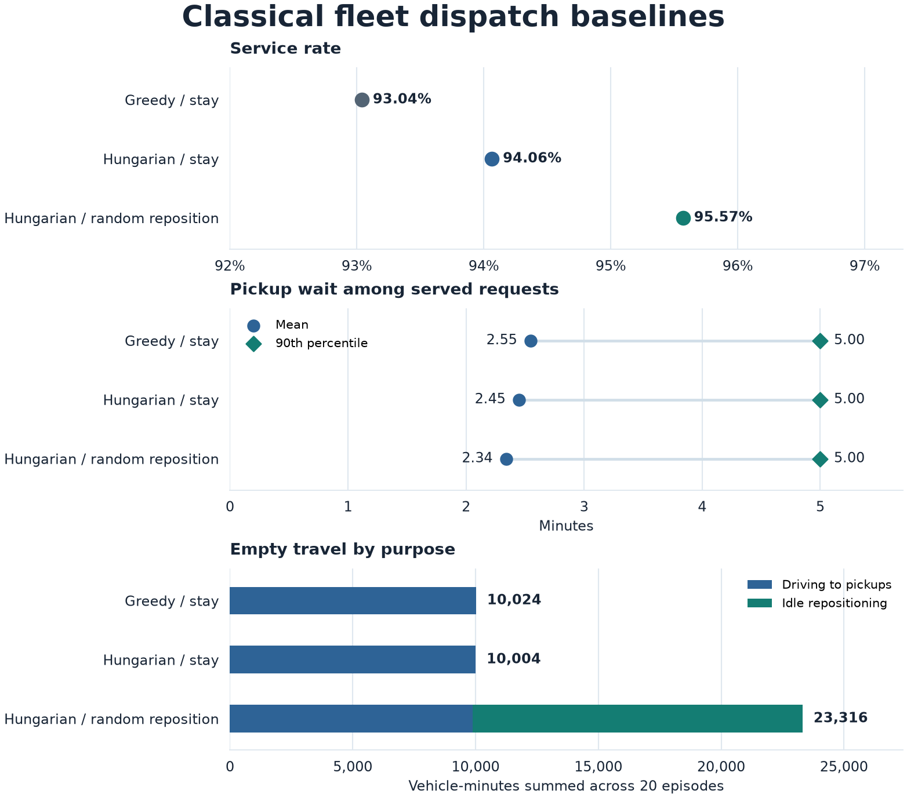
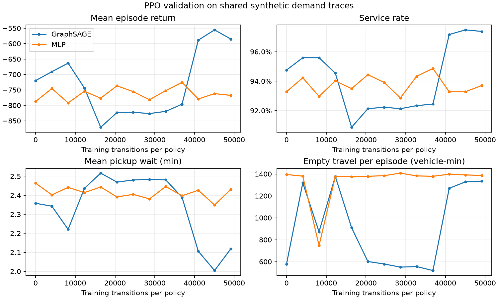
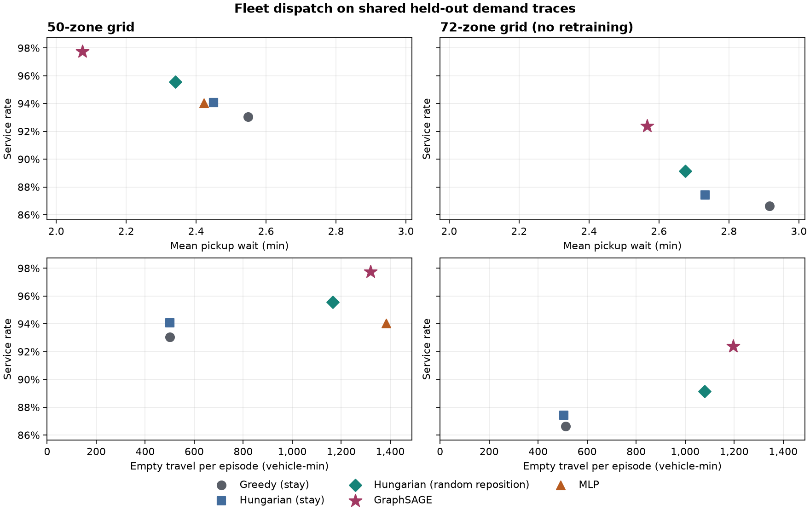
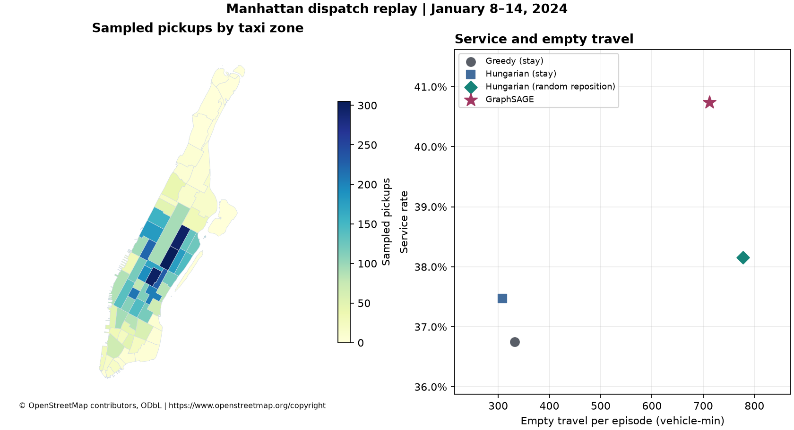
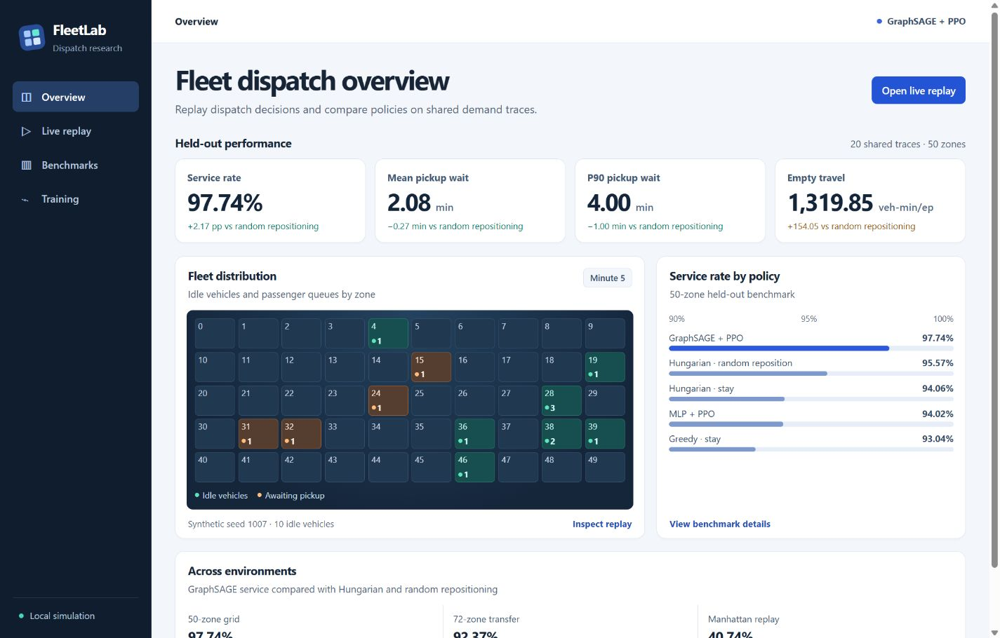

# FleetLab · Learning where idle taxis should wait

[Open the FleetLab dashboard](https://shivam3746.github.io/fleet-rl/)

FleetLab simulates a taxi fleet that must pick up passengers before their requests expire. It compares a learned idle-vehicle repositioning policy with classical dispatch rules on synthetic grids and a replay of Manhattan taxi records.

**The main result:** On 20 held-out 50-zone traces, GraphSAGE with PPO served **97.74%** of requests, compared with **95.57%** for Hungarian dispatch with random repositioning. Its mean pickup wait fell from **2.34 to 2.08 minutes**, and it spent **154 more empty vehicle-minutes per episode**. In the Manhattan replay, the same checkpoint served more requests **and** drove fewer empty minutes than random repositioning. The Manhattan figures describe the simulator and its sampled workload.

[Problem and approach](#the-problem) · [Data and evaluation](#data-and-evaluation) · [Results](#results) · [Run locally](#reproduce-the-project-locally) · [Dashboard walkthrough](#dashboard-walkthrough)

## The problem

Every minute, a fleet operator has two decisions to make:

1. **Dispatch.** Which idle vehicle should pick up each waiting passenger?
2. **Reposition.** Where should vehicles with no assigned passenger go before the next requests appear?

Consider two neighborhoods, one with idle taxis and one where demand is about to rise. Staying put saves travel now. Moving a taxi early can shorten a future pickup, but that taxi is temporarily unavailable to either neighborhood while traveling. With finite vehicles, changing demand, pickup deadlines, and trips that tie up taxis for several minutes, the cheapest action right now may make the next few minutes harder.

The project asks whether a policy can learn when and where idle taxis should move. It keeps request assignment fixed when comparing repositioning strategies, so improvements can be attributed to the policy controlling idle vehicles under the same dispatcher.

## How the solution works

One simulator step is one minute:

1. New passenger requests enter the queue. The Hungarian dispatcher matches idle vehicles to passengers who can still be picked up by their deadline. It first maximizes the number of feasible assignments, then minimizes total travel to those pickups.
2. The policy observes the remaining idle vehicles, waiting requests, and expected vehicle availability. Each idle vehicle can stay or take a legal move toward another zone. Action masks remove unavailable moves and keep busy vehicles on their current trips.
3. The simulator advances time and records pickups, drop-offs, waiting, and empty travel. A pickup at its deadline counts as served. Once arrivals stop, the simulator continues until every request has been picked up or expired.

| Design decision | Why it was made | Tradeoff |
| --- | --- | --- |
| Keep Hungarian assignment fixed for the learned policies | Separates the effect of moving idle vehicles from how existing requests are assigned | The learned policy cannot defer or change an assignment |
| Represent the city as a graph of zones | Each zone carries its own state and can receive information from neighboring zones | Vehicles and demand are represented at zone level, with approximate travel within a zone |
| Use GraphSAGE message passing | A zone can use nearby supply and demand, and the same weights can run on a different graph size | A model trained on one graph can still struggle when demand or travel conditions change |
| Train with Proximal Policy Optimization (PPO) | The policy learns from simulated outcomes without labeled dispatch decisions | Each training run requires simulator experience, and the best validation checkpoint may occur before the last update |
| Penalize waiting and expiry | Each passenger-minute of wait costs 1, and each expired request costs 10. Passengers keep accruing wait after assignment until pickup or expiry | The reward gives no direct cost to empty driving. We report it alongside service and wait |
| Compare with a plain MLP under the same setup | Tests whether graph structure helps beyond simply learning a policy. Both models use the same features, actions, dispatcher, and training budget, with about 21.7k and 21.6k parameters | The dense MLP expects a fixed-size grid, so it is evaluated on the 50-zone grid |

The policy sees the current minute and time until new arrivals stop. For each zone it sees the idle taxi count, unassigned requests, age of the oldest unassigned request, and vehicles expected to become idle within five minutes. GraphSAGE exchanges these signals over the zone graph. Both policies score moves using information about the vehicle's origin and candidate destination. The simulator supplies observations and rewards through [Gymnasium](fleet_rl/env.py). The [policy](fleet_rl/policy.py) and [PPO update](fleet_rl/ppo.py) are implemented in PyTorch. [GraphSAGE paper](https://arxiv.org/abs/1706.02216) · [PPO paper](https://arxiv.org/abs/1707.06347)

### How the project was built

| Stage | What was built or checked |
| --- | --- |
| Problem definition | Defined observations, legal actions, pickup deadlines, reward, and metrics |
| Simulator | Built a 5 × 10 grid and tested pickups, expiration, vehicle movement, and episode termination |
| Classical baselines | Added nearest-vehicle greedy dispatch, stationary Hungarian dispatch, and Hungarian with random repositioning |
| Learned policies | Built GraphSAGE and a plain multilayer perceptron (MLP) using the same observations and decisions |
| Training | Trained both policies with PPO and saved the best validation and final checkpoints |
| Held-out evaluation | Replayed fixed demand traces with all policies, then transferred the graph checkpoint to a 72-zone grid |
| Manhattan benchmark | Used TLC trip timings and zones plus directed OpenStreetMap travel times for empty legs |
| Operator and demo | Added a local natural-language operator, live dashboard, and a static version with recorded runs |

## Data and evaluation

| Dataset or split | What it contains | What it tests |
| --- | --- | --- |
| Synthetic training | 50 zones, 20 taxis, 120 minutes of arrivals, demand seeds starting at `10000` | Learning to reposition on a grid with shifting demand |
| Synthetic validation | Four traces, seeds `2000`–`2003`, separate from training | Checkpoint selection by mean validation return |
| Held-out synthetic | 20 traces, seeds `1000`–`1019`, with 4,784 requests on each of the 50- and 72-zone grids | Comparing policies on the training grid and testing transfer without retraining |
| Manhattan | 5,265 sampled yellow taxi trips over 14 two-hour windows, covering 66 connected taxi zones | Testing the synthetic-trained graph policy with observed trip patterns and a road network |

Synthetic demand arrives at an average of two requests per minute. The active hotspot switches between opposite corners every 30 minutes. For each request, the origin is drawn from the active region 85% of the time and from the full grid otherwise. Traffic in the grid moves at one minute per edge. All policies within an evaluation use the same demand trace and starting fleet, and all requests have a five-minute pickup deadline.

For Manhattan, the workload comes from January 8–14, 2024, using windows beginning at 08:00 and 17:00 New York time. We retain trips with pickup and drop-off in the connected Manhattan zones, a positive recorded distance, and a metered duration of 1–120 minutes. A seeded sample keeps about 4% of eligible trips, giving 5,265 trips for a simulated fleet of 20 taxis per window. We use TLC pickup and drop-off times and zone IDs. Recorded distance filters unusable trips. Fares, tips, and other payment fields play no role. [TLC trip records](https://www.nyc.gov/site/tlc/about/tlc-trip-record-data.page) · [Yellow taxi data dictionary](https://www.nyc.gov/assets/tlc/downloads/pdf/data_dictionary_trip_records_yellow.pdf)

TLC meter-on time stands in for the passenger's request time. Meter-on to meter-off duration determines how long the simulated taxi carries that passenger. For empty travel, each taxi zone is anchored to a representative road node inside its boundary. The November 21, 2026 OpenStreetMap extract yielded 102,847 connected road nodes and 149,928 directed road segments. Empty legs use shortest estimated free-flow times rounded up to minutes, with immediate pickups when a vehicle is already in the pickup zone. The road data comes from a later snapshot than the trip records. [BBBike New York extract](https://download.bbbike.org/osm/bbbike/NewYork/) · [© OpenStreetMap contributors, ODbL](https://www.openstreetmap.org/copyright)

### How to read the metrics

- **Service rate** is the share of all requests picked up by their deadline.
- **Mean and P90 pickup wait** measure request arrival to pickup among served passengers. A P90 of 4 minutes means at least 90% of served passengers were picked up within roughly four minutes. Read waits next to service rate because policies can serve different groups of passengers.
- **Empty travel** adds every minute spent driving to pickups or moving an idle taxi. Ten taxis driving empty for one minute each add ten vehicle-minutes.
- **Episode return** adds the simulator's wait and expiry rewards. Higher is better. PPO used a 0.1 reward scale internally, and reported validation returns use the original reward units.

## Results

### Held-out 50-zone grid

Every policy saw the same 4,784 requests. Waits are calculated across all served passengers, and empty travel is averaged per episode.

| Policy | Served / requests | Service rate | Mean wait | P90 wait | Empty vehicle-min/episode |
| --- | ---: | ---: | ---: | ---: | ---: |
| Greedy, stay idle | 4,451 / 4,784 | 93.04% | 2.55 min | 5.00 min | 501.20 |
| Hungarian, stay idle | 4,500 / 4,784 | 94.06% | 2.45 min | 5.00 min | 500.20 |
| Hungarian, random repositioning | 4,572 / 4,784 | 95.57% | 2.34 min | 5.00 min | 1,165.80 |
| MLP + PPO | 4,498 / 4,784 | 94.02% | 2.42 min | 5.00 min | 1,382.70 |
| **GraphSAGE + PPO** | **4,676 / 4,784** | **97.74%** | **2.08 min** | **4.00 min** | **1,319.85** |

Greedy visits requests in arrival order and assigns the nearest feasible available taxi. Stationary Hungarian served 49 more requests with nearly identical empty travel. Random repositioning kept the Hungarian dispatcher and sampled uniformly from each idle vehicle's legal moves, including staying. That raised service further, and much of its travel went to moving idle vehicles. GraphSAGE served 104 more requests than random repositioning, at a cost of 154.05 additional empty vehicle-minutes per episode. It served 178 more requests than the learned MLP and used 62.85 fewer empty vehicle-minutes per episode.



### Training and checkpoint selection

Both models trained for 49,152 transitions, with 96 PPO updates across eight simulator instances, 64 steps per rollout and 64 hidden features. The run used model seed `7` and CPU execution. Both checkpoint selections used the same four validation traces and the highest mean episode return.

| Policy | Initial validation return | Best validation return | Best checkpoint | Service at best | Mean wait at best |
| --- | ---: | ---: | ---: | ---: | ---: |
| GraphSAGE | −719.75 | −555.50 | 45,056 transitions | 97.48% | 2.00 min |
| MLP | −787.50 | −725.50 | 36,864 transitions | 94.86% | 2.40 min |



### Transfer to more zones

The same GraphSAGE weights ran on a 6 × 12 grid without retraining. Both grid sizes used 20 vehicles, and the held-out comparison paired the same 20 traces within each grid.

| Policy | Served / requests | Service rate | Mean wait | P90 wait | Empty vehicle-min/episode |
| --- | ---: | ---: | ---: | ---: | ---: |
| Greedy, stay idle | 4,144 / 4,784 | 86.62% | 2.92 min | 5.00 min | 511.55 |
| Hungarian, stay idle | 4,183 / 4,784 | 87.44% | 2.73 min | 5.00 min | 505.50 |
| Hungarian, random repositioning | 4,265 / 4,784 | 89.15% | 2.68 min | 5.00 min | 1,079.00 |
| **GraphSAGE + PPO** | **4,419 / 4,784** | **92.37%** | **2.57 min** | **5.00 min** | **1,195.55** |

GraphSAGE served 154 more requests than random repositioning and used 116.55 more empty vehicle-minutes per episode. P90 wait stayed at five minutes for all four policies.



### Manhattan taxi replay

| Policy | Served / requests | Service rate | Mean wait | P90 wait | Empty vehicle-min/window |
| --- | ---: | ---: | ---: | ---: | ---: |
| Greedy, stay idle | 1,935 / 5,265 | 36.75% | 3.85 min | 5.00 min | 332.64 |
| Hungarian, stay idle | 1,973 / 5,265 | 37.47% | 3.38 min | 5.00 min | 308.64 |
| Hungarian, random repositioning | 2,009 / 5,265 | 38.16% | 3.39 min | 5.00 min | 777.29 |
| **GraphSAGE + PPO** | **2,145 / 5,265** | **40.74%** | **3.34 min** | **5.00 min** | **711.86** |

GraphSAGE transferred without retraining. It served 136 more requests than random repositioning and used 65.43 fewer empty vehicle-minutes per window. Stationary Hungarian still used less empty travel than GraphSAGE. The much lower service rates show how demanding this sampled workload was for the 20-vehicle simulated fleet under a five-minute deadline.



### Uncertainty and limitations

The table reports GraphSAGE minus Hungarian with random repositioning. The bracketed values are paired 95% bootstrap intervals from 10,000 resamples of shared episodes.

| Grid or replay | Service difference, percentage points | Mean wait difference, minutes | Empty travel difference, vehicle-min/episode |
| --- | ---: | ---: | ---: |
| 50 zones | +2.17 [1.55, 2.82] | −0.27 [−0.34, −0.20] | +154.05 [137.35, 170.50] |
| 72 zones | +3.22 [2.46, 3.96] | −0.11 [−0.18, −0.04] | +116.55 [100.30, 131.40] |
| Manhattan | +2.58 [1.18, 4.29] | −0.056 [−0.117, +0.003] | −65.43 [−97.50, −35.71] |

The intervals quantify variation across demand episodes for **one training seed**. In Manhattan the mean-wait interval includes zero. TLC trip records represent completed metered trips and provide a proxy for request arrivals. The sampled workload, synthetic taxi placements, zone representatives, and approximate free-flow routing limit how far these results generalize to actual NYC waits or fleet operations.

## Reproduce the project locally

The commands below use **Windows PowerShell**, Git, and **64-bit Python 3.11**. CPU is enough for the full experiment. The reported run used Python 3.11 and PyTorch 2.11.0, with training on the CPU. On macOS or Linux, use `python3.11` and `./.venv/bin/python`, and choose the PyTorch installation for your platform. [PyTorch installation guide](https://pytorch.org/get-started/locally/)

### 1. Clone, install, and test

```powershell
git clone https://github.com/shivam3746/fleet-rl.git
cd fleet-rl
py -3.11 -m venv .venv
$python = '.\.venv\Scripts\python.exe'
& $python -m pip install torch==2.11.0 --index-url https://download.pytorch.org/whl/cpu
& $python -m pip install -r requirements.txt
& $python -B -m unittest discover -s tests -v
```

### 2. Benchmark, train, and evaluate the synthetic workloads

```powershell
& $python -B -m fleet_rl.baselines --seed-start 1000 --episodes 20 --reposition-seed 0
& $python -B -m fleet_rl.train --output-dir runs/step5-ppo --updates 96 --num-envs 8 --rollout-steps 64 --eval-every 8 --seed 7 --device cpu
& $python -B -m fleet_rl.evaluate --run-dir runs/step5-ppo --output-dir runs/step6-evaluation
```

The baseline command prints the comparison table. Training writes `graph/best.pt`, `mlp/best.pt`, the final checkpoints, `metrics.jsonl`, `run.json`, and `learning_curves.png` under `runs/step5-ppo`. Evaluation writes `evaluation.json` and `held_out_comparison.png` under `runs/step6-evaluation`. Reports include the evaluation configuration, episode outcomes, and checkpoint hashes. Use a fresh output directory when repeating a run to retain prior results.

### 3. Download the Manhattan inputs and run the benchmark

Create `runs/step7-data` and save these files there using the exact names shown.

| File | Used for |
| --- | --- |
| [NewYork.osm.pbf](https://download.bbbike.org/osm/bbbike/NewYork/NewYork.osm.pbf) | Directed road graph and empty-vehicle travel times |
| [taxi_zones.zip](https://d37ci6vzurychx.cloudfront.net/misc/taxi_zones.zip) | Official taxi-zone polygons |
| [yellow_tripdata_2024-01.parquet](https://d37ci6vzurychx.cloudfront.net/trip-data/yellow_tripdata_2024-01.parquet) | Request location, pickup time, and observed passenger-trip duration |

```powershell
New-Item -ItemType Directory -Force runs/step7-data | Out-Null
# Download the three files above into runs/step7-data before running the benchmark.
& $python -B -m fleet_rl.nyc_benchmark --data-dir runs/step7-data --checkpoint runs/step5-ppo/graph/best.pt --output-dir runs/step7-manhattan
```

This generates `manhattan_evaluation.json` and `manhattan_comparison.png`. The BBBike download is refreshed over time. To reproduce the exact road graph, use the November 21, 2026 extract with SHA-256 `8d24d35d4aa6a57f28c84d9fd4d2699b4b007759e1cd170f9da8f86e389d5a53`. A newer file runs the same benchmark protocol on updated roads. The three input files are about 205 MB combined for the original run. Input and generated files stay under the ignored `runs/` directory.

### 4. Start the local dashboard

```powershell
& $python -B -m fleet_rl.dashboard
```

Keep that terminal open and visit [http://127.0.0.1:8765](http://127.0.0.1:8765/). If the port is in use, pass `--port 8766` and open that port. The dashboard can show synthetic playback after training. Its benchmark tabs fill in as the corresponding local reports are generated. To prepare a static site without the Python server, complete the benchmarks and run `& $python -B -m fleet_rl.export_dashboard --output runs/step9-dashboard/website`.

### 5. Optional natural-language operator

The operator interprets requests through a local Qwen2.5 model running in llama.cpp. FleetLab's simulator and reports provide the facts in replies. The terminal operator can start, advance, inspect, and explain synthetic or Manhattan replays. The dashboard's operator panel answers questions about the current synthetic replay and saved comparisons.

Download and extract the Windows CPU x64 runtime from [llama.cpp b12810](https://github.com/ggml-org/llama.cpp/releases/tag/b12810) into `runs/step8-llm/llama`. Save the [Qwen2.5 1.5B Instruct Q4_K_M model](https://huggingface.co/Qwen/Qwen2.5-1.5B-Instruct-GGUF/blob/main/qwen2.5-1.5b-instruct-q4_k_m.gguf) as `runs/step8-llm/qwen2.5-1.5b-instruct-q4_k_m.gguf`. The verified run used the same quantization from the [Ollama model registry](https://ollama.com/library/qwen2.5:1.5b). The interface runs locally without an API key.

In one PowerShell terminal, start the model server from the repository root.

```powershell
.\runs\step8-llm\llama\llama-server.exe --model .\runs\step8-llm\qwen2.5-1.5b-instruct-q4_k_m.gguf --alias fleet-operator --host 127.0.0.1 --port 18084 -c 2048 -t 4 --parallel 1 --no-ui
```

Then use the dashboard's operator panel, or run `.\.venv\Scripts\python.exe -B -m fleet_rl.operator` in another terminal. Example terminal requests include “Start a synthetic replay with seed 1007,” “Advance five minutes,” and “Explain the latest decision.” The dashboard and replay controls work with the model server stopped.

## Dashboard walkthrough

1. **Overview** shows held-out service, pickup wait, and empty travel, plus the fleet's current distribution on the zone map.
2. **Recorded replay** on the hosted site lets you pick one of the 20 held-out seeds (`1000`–`1019`), play or pause, step forward, and finish the run. Select a zone to see idle vehicles, passengers awaiting pickup, and inbound availability. Latest decisions shows what the dispatcher and model actually did. **Live replay** on the local site generates a new simulation for any supported seed.
3. **Benchmarks** switches among the 50-zone grid, 72-zone transfer, and Manhattan. Each view shows the same measures for every tested policy, with paired intervals for the GraphSAGE differences.
4. **Training** plots how episode return, service, mean wait, and empty travel changed across PPO updates for GraphSAGE and the MLP.

For a short demo, load seed **1007** and select **Finish replay**. The published recording ends at minute **121**, with **243 of 247 requests served** and a **2.16-minute** mean pickup wait.


